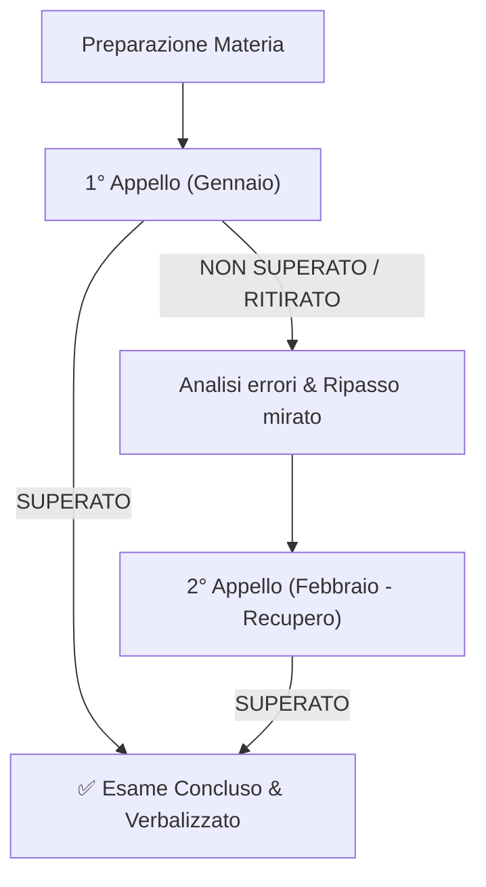
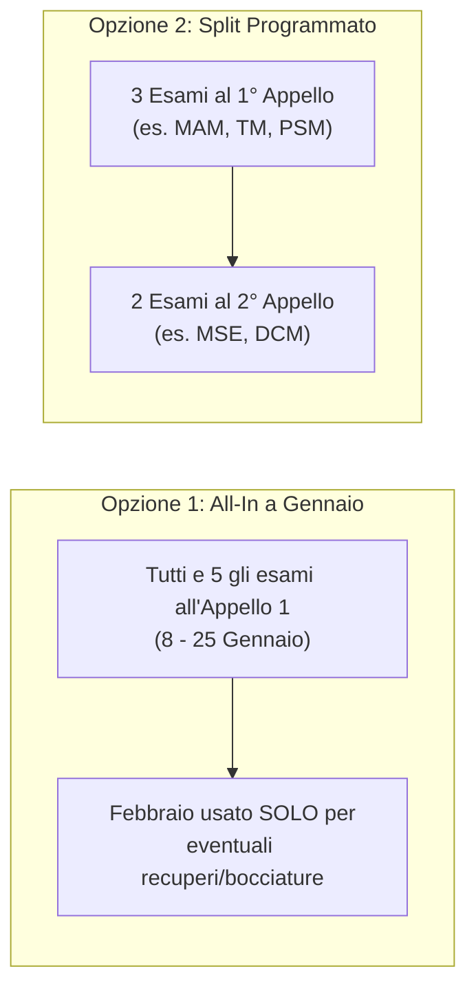

# Calendario Sessione Invernale 2026/2027
**Corso di Laurea**: Ingegneria Meccanica — Politecnico di Milano  
**Periodo di riferimento**: 26 Ottobre 2026 – 28 Febbraio 2027  

---

## 1. Filosofia di Sessione: Tentativo Principale & Slot di Recupero

L'obiettivo è superare ciascuno dei **5 esami** una sola volta. Il calendario è strutturato secondo il principio del **Piano A (Target Primario)** e **Piano B (Safety Net / Recupero)**:

> [!TIP] **Vantaggio Strategico dell'8 Gennaio (MAM)**  
> Chiudere **Meccanica Applicata alle Macchine (MAM)** al primo appello (08/01) non solo toglie l'esame più pesante all'inizio della sessione, ma **annulla automaticamente il potenziale conflitto dell'8 febbraio** con Dinamica e Controllo delle Macchine (DCM).

---

## 2. Tabella degli Appelli & Finestre di Recupero

| Materia | Sigla | 🎯 Tentativo Principale (Gennaio) | 🔄 Slot di Recupero (Febbraio) | Giorni tra 1° e 2° Tentativo |
| :--- | :---: | :---: | :---: | :---: |
| **Meccanica Applicata alle Macchine** | **MAM** | **08/01/2027** (Ven) | **08/02/2027** (Lun) | 31 giorni |
| **Tecnologia Meccanica** | **TM** | **13/01/2027** (Mer) | **03/02/2027** (Mer) | 21 giorni |
| **Macchine e Sistemi Energetici** | **MSE** | **18/01/2027** (Lun) | **10/02/2027** (Mer) | 23 giorni |
| **Dinamica e Controllo delle Macchine** | **DCM** | **20/01/2027** (Mer) | **08/02/2027** (Lun) | 19 giorni |
| **Progettazione di Sistemi Meccanici** | **PSM** | **25/01/2027** (Lun) | **15/02/2027** (Lun) | 21 giorni |

---

## 3. Due Possibili Strategie di Esecuzione

- **Opzione 1 (All-in a Gennaio)**: Tenti tutti i 5 esami tra l'8 e il 25 gennaio. Se ne passi 3 o 4, hai febbraio completamente focalizzato solo sui restanti. *Richiede di arrivare a fine dicembre con tutti i programmi completati.*
- **Opzione 2 (Split Strategico)**: Scegli fin da ora 2-3 esami da dare al 1° appello e 2 esami da preparare direttamente per il 2° appello di febbraio. *Permette di concentrarsi con più profondità e meno dispersione.*

---

## 4. Cronoprogramma Generale

### Fase 1: Semestre Didattico (26 Ottobre – 18 Dicembre 2026)
- **Obiettivo**: Seguire le lezioni, completare la teoria e schematizzare gli argomenti principali per non arrivare a ridosso degli appelli con materiale arretrato.
- **Settimane**: W1 (26 Ott) – W8 (18 Dic).

### Fase 2: Sprint Pre-Appelli (19 Dicembre 2026 – 07 Gennaio 2027)
- **Focus Assoluto**: **Meccanica Applicata alle Macchine (MAM)** + consolidamento prima materia successiva.
- **Esercitazioni**: Risoluzione temi d'esame e simulazioni a tempo.

### Fase 3: Giro 1 degli Appelli (08 Gennaio – 25 Gennaio 2027)
- **08/01 (Ven)**: 🎯 **MAM (1° Appello)**
- *09–12 Gen*: 4 giorni di focus TM
- **13/01 (Mer)**: 🎯 **TM (1° Appello)**
- *14–17 Gen*: 4 giorni di focus MSE
- **18/01 (Lun)**: 🎯 **MSE (1° Appello)**
- *19 Gen*: 1 giorno di ripasso/rifinitura DCM
- **20/01 (Mer)**: 🎯 **DCM (1° Appello)**
- *21–24 Gen*: 4 giorni di focus PSM
- **25/01 (Lun)**: 🎯 **PSM (1° Appello)**

### Fase 4: Giro 2 / Finestra di Recupero (26 Gennaio – 15 Febbraio 2027)
- *26 Gen – 02 Feb*: Buffer di recupero e preparazione 2° appello TM
- **03/02 (Mer)**: 🔄 **TM (Recupero 2° Appello)**
- *04–07 Feb*: Preparazione specifica MAM o DCM
- **08/02 (Lun)**: 🔄 **MAM (Recupero 2° App.)** / 🔄 **DCM (Recupero 2° App.)**
- *09 Feb*: Buffer MSE
- **10/02 (Mer)**: 🔄 **MSE (Recupero 2° Appello)**
- *11–14 Feb*: Buffer PSM
- **15/02 (Lun)**: 🔄 **PSM (Recupero 2° Appello)**

---

## 5. Prossimi Passi

- [ ] Inserire il programma dettagliato di **Meccanica Applicata alle Macchine** per pianificare lo studio settimana per settimana da oggi fino all'8 gennaio.
- [ ] Decidere se puntare sull'**Opzione 1 (All-in)** o sull'**Opzione 2 (Split Strategico)** per calibrare i ritmi di studio da novembre a gennaio.
