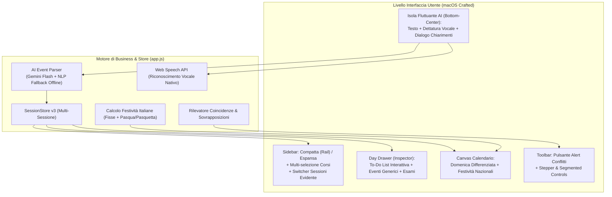
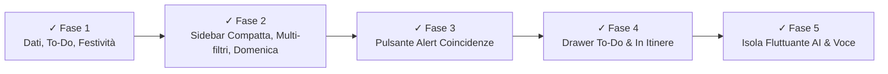

# Piano di Sviluppo & Roadmap: Nuove Funzionalità "MySession"

Questo documento definisce il piano d'azione dettagliato e modulare per l'estensione di **MySession**, trasformando l'applicazione in una suite completa per la gestione della sessione universitaria con supporto all'intelligenza artificiale, dettatura vocale, to-do list giornaliere, gestione prove in itinere, festività e navigazione ottimizzata.

---

## Panoramica dell'Architettura delle Nuove Funzionalità

---

## Le 5 Fasi di Realizzazione

### Fase 1: Architettura Dati & Modello di Dominio
**Obiettivo:** Estendere la struttura dati in `app.js` e la persistenza `localStorage` senza rompere i dati attuali.

1. **Estensione Modello Dati (`SessionStore`):**
   - **Prove in Itinere:** Supporto al tipo esame `itinere` con 2 date correlate (1° e 2° prova in itinere) e punteggi/dettagli associati.
   - **Eventi Generici:** Array `genericEvents` per ogni sessione (`{ id, date, title, time, category, details }` es. lezioni, scadenze, sessioni studio intensive).
   - **To-Do List Giornaliere:** Oggetto `todos` indicizzato per sessione e data ISO (`{ id, text, done, createdAt }`).
2. **Motore Festività Italiane:**
   - Implementazione algoritmo per festività fisse (Capodanno, Epifania, 25 Aprile, 1 Maggio, 2 Giugno, Ferragosto, Tutti i Santi, Immacolata, Natale, S. Stefano).
   - Calcolo matematico (Meeus/Jones) per Pasqua e Lunedì dell'Angelo (Pasquetta) per qualunque anno (2026, 2027, ecc.).

---

### Fase 2: UI & Navigazione Avanzata (Sidebar, Filtri, Sessioni, Calendario)
**Obiettivo:** Potenziare l'usabilità complessiva e rendere l'interfaccia flessibile e accessibile.

1. **Sidebar a 3 Stati (Espansa, Compatta "Rail", Nascosta):**
   - Introduzione della modalità **Compatta (Rail Mode)**: la sidebar si stringe mostrando icone intuitive per cambiare vista, saltare ai mesi e accedere ai corsi senza occupare spazio sul canvas.
2. **Multi-Selezione Corsi della Sessione:**
   - Riorganizzazione dei filtri materie: passaggio da selezione singola a **multi-selezione simultanea** (checkbox pill con stato attivo/disattivo multiplo).
   - Possibilità di visualizzare contemporaneamente solo gli esami di 2 o 3 materie scelte, oppure tutte.
3. **Pulsante Cambio Sessione Più Accessibile:**
   - Riprogettazione del selettore in cima alla sidebar con pulsante evidenziato in stile pillola Apple, indicatore di sessione attiva ben visibile e scorciatoia rapida.
4. **Differenziazione della Domenica:**
   - Trattamento visivo distinto per la colonna della Domenica: tonalità di sfondo leggermente più calda/morbida, header colorato discretamente e bordo di separazione per marcare la fine della settimana.

---

### Fase 3: Centro Notifiche & Pulsante "Alert" per le Coincidenze
**Obiettivo:** Isolare errori e coincidenze in un punto di controllo dedicato e non invasivo.

1. **Pulsante "Alert" nella Toolbar:**
   - Badge con icona di attenzione e contatore dinamico dei conflitti (es. `⚠️ 1 Conflitto`).
   - Se non ci sono conflitti, il pulsante assume stato neutro (`✓ Nessun conflitto`).
2. **Popover Dettagli Conflitti:**
   - Click sul pulsante apre un popover dedicato che elenca con precisione le coincidenze (es. *"Lunedì 08 Febbraio 2027: MAM 2° Appello + DCM 2° Appello"*).
   - Click su un conflitto porta istantaneamente il calendario a quella data e apre il drawer.

---

### Fase 4: Day Drawer (To-Do List, Eventi Generici, In Itinere)
**Obiettivo:** Rendere il cassetto laterale il vero centro operativo della giornata dello studente.

1. **To-Do List Interattiva:**
   - Blocco dedicato nel drawer: input rapido per aggiungere un'attività ("Studiare cinematica", "Esercizi tema esame 2024").
   - Checkbox con micro-animazione tattile, depennamento testo e pulsante elimina.
   - Indicatore a pallini o barra di avanzamento nella cella del giorno sul calendario.
2. **Aggiunta Evento Generico:**
   - Pulsante nel drawer "+ Evento": consente di inserire promemoria, scadenze progetti, lezioni o blocchi di studio con orario e categoria.
3. **Form Esami con Prove in Itinere:**
   - Nuova opzione nel selettore del turno d'esame: *"Prove in Itinere (1° e 2° Parziale)"*.
   - Compaiono due campi data distinti che creano contestualmente i due appelli collegati nel calendario.

---

### Fase 5: Isola Fluttuante AI (Dettatura Vocale, Testo & Domande di Chiarimento)
**Obiettivo:** Inserimento ultrarapido in linguaggio naturale vocale o digitato.

1. **Isola Fluttuante (Bottom-Center):**
   - Barra fluttuante in stile Apple Dynamic Island / Siri, posizionata in basso al centro con sfocatura *Liquid Glass*.
   - Include pulsante Microfono, campo di testo e pulsante Invio.
2. **Riconoscimento Vocale Istantaneo:**
   - Utilizzo di `webkitSpeechRecognition` nativo di WebView2 (Edge/Chromium): zero dipendenze esterne, trascrizione in tempo reale in lingua italiana.
3. **Parser Intelligente AI & Domande di Chiarimento:**
   - Modulo di interpretazione (con supporto API Gemini Flash opzionale + parser euristico locale per funzionare sempre offline).
   - **Logica di chiarimento interattivo:** se l'utente dice *"Metti l'esame il 15 gennaio"* ma non specifica la materia o il turno, l'isola fluttuante si espande chiedendo:
     - *"Per quale materia desideri inserire l'esame?"* (con pulsanti rapidi per le materie attive).
     - Se manca la data: *"In quale data si terrà l'appello?"*.
   - Anteprima schedata prima della conferma definitiva.

---

## Ordine di Esecuzione & Stato di Avanzamento

### Checklist Implementazione Completata
- [x] **Fase 1 (Dati & Modello):** Gestione To-Do in `SessionStore`, array eventi generici, algoritmo Pasqua Meeus/Jones e calendario festività italiane fisse e mobili.
- [x] **Fase 2 (UI & Navigazione):** Sidebar ciclica (Espansa / Compatta Rail 68px / Nascosta), multi-selezione corsi simultanea con conteggi dinamici, pulsante cambio sessione prominente con stato attivo, domeniche differenziate visivamente.
- [x] **Fase 3 (Centro Notifiche):** Pulsante `btnToolbarAlert` dedicato con conteggio dinamico conflitti e popover informativo con navigazione istantanea.
- [x] **Fase 4 (Day Drawer):** Sezione To-Do interattiva con avanzamento percentuale, inserimento rapido eventi generici personalizzati, supporto nativo alle 2 prove parziali in itinere con date collegate.
- [x] **Fase 5 (Isola Fluttuante AI):** Barra fluttuante in stile Apple Dynamic Island in basso al centro, riconoscimento vocale continuo Web Speech API in lingua italiana, parser semantico in linguaggio naturale con dialoghi interattivi di chiarimento se mancano materia o data.
- [x] **Fase 6 (Settings Menu, Sidebar Compatta 2.0 & Dettatura Ottimizzata):**
  - **Menu Impostazioni:** Modale Apple macOS con selezione tema (Chiaro/Scuro/Auto), opzioni predefinite di zoom interfaccia tramite Segmented Control tattile (85% Compatto, 90% Ridotto, 100% Standard, 115% Medio, 125% Grande), palette accento e festività con picker esadecimale, giorno inizio settimana (Lunedì/Domenica/Sabato) ed evidenziazione giorno festivo della settimana.
  - **Sidebar Compatta Rifatta da Zero:** Rimossa l'eliminazione totale (no 0px). Modalità compatta con tasto sessione monogramma "MS" interattivo, mini-widget counter countdown al primo esame sempre visibile e chip esami compatti con sigla, colore e tooltip.
  - **Dettatura Vocale AI fluida:** La trascrizione vocale viene mostrata live senza interrompere l'utente; l'AI attende il termine completo della dettatura (`onend`) prima di analizzare il testo e porre domande di chiarimento.
- [x] **Fase 7 (Fluid Morphing & Spring Physics):**
  - **Transizione Continua Senza Scatti:** Eliminazione di qualsiasi `display: none` che interrompa l'interpolazione CSS.
  - **Fisica delle Molle Apple:** Curva di accelerazione personalizzata `--ease-morph: cubic-bezier(0.16, 1, 0.3, 1)` a 340ms su container (`width`, `min-width`, `padding`) e su tutti gli elementi figli in simultanea.
  - **Morphing degli Elementi Chiave:**
    - *Header:* Brand text sfuma via con traslazione a sinistra mentre il pulsante sessione morpha in uno squircle centrato da 52x48px con monogramma "MS" e dot verde.
    - *Telemetry:* I box metrici inferiori collassano verticalmente ad altezza zero, mentre la cifra dei giorni mancanti si ridimensiona fluidamente (da `1.75rem` a `1.15rem`) assieme alla sigla dell'esame target in capsula interattiva.
    - *Corsi:* I chip dei corsi si contraggono in capsule da 52x38px con bordo sinistro colorato e sigla in grassetto, con dissolvenza orizzontale di checkbox e denominazione.
    - *Aggiungi Esame:* Il pulsante collassa nell'icona `+` quadrata smussata e centrata.
    - *Sezioni secondarie:* Mesi rapidi, scorciatoie e banner avvisi si ripiegano con transizione coordinata di `max-height`, `opacity` e `transform`.
- [x] **Fase 8 (Fluid Window Adaptation & Responsive System):**
  - **Auto-adattamento Intelligente su Ridimensionamento:** Listener debounced sul resize della finestra che fa transitare automaticamente la sidebar in modalità compatta (72px) sotto i 1180px, restituendo spazio prezioso al calendario, e la ripristina se allargata (rispettando sempre la scelta manuale dell'utente).
  - **Toolbar Responsiva a 4 Livelli:**
    - Spaziatura dinamica con `clamp()` e rimozione del `min-width` fisso su leading/center/trailing.
    - Scambio semantico etichette pulsante Esame ("Aggiungi Esame / Appello" -> "Aggiungi" -> solo icona `+`).
    - Compattamento pulsante Alert (nasconde testo "Alert", mantiene icona triangolo + badge numerico).
    - Switcher viste compatto ("Cont.", "Mese", "Sett.", "Appelli") e occultamento del filtro secondario su schermi stretti per non comprimere i controlli primari.
    - Selezione tema nella toolbar nascosta automaticamente su schermi stretti (sempre accessibile in Impostazioni `Ctrl+,`).
  - **Allineamento Griglia e Header Giorni:** Aggiunta di `--grid-gap: clamp(3px, 0.55vw, 6px)` sia alla barra sticky dei giorni sia alla griglia del calendario per un perfetto allineamento pixel-su-pixel a qualsiasi larghezza.
  - **Prevenzione Grid Blowout:** Impostazione di `min-width: 0; overflow: hidden; text-overflow: ellipsis;` su celle giornaliere, badge esami, pill festività e to-do.
  - **Adattamento Verticale (Finestre Basse):** Dimensionamento proporzionale delle celle con `--day-cell-min-h: clamp(80px, 12vh, 114px)` e supporto a schermi con altezza < 740px e < 600px.
  - **Drawer, Modali, Isola AI & Layout Fluidi:** Sostituzione delle unità viewport fisse (`100vw`/`100vh`) con layout fluido `100%` e `flex: 1` su `html`, `body` e `.app-layout`. L'interfaccia si adatta con precisione millimetrica a qualsiasi livello di zoom (85%-125%) ed a qualsiasi ridimensionamento della finestra, eliminando tagli sui bordi destri e bande scure laterali.
- [x] **Fase 9 (Copilot AI ad Accesso Totale):**
  - **Controllo Totale Impostazioni dell'App:**
    - *Tema:* comandi vocali/testo per tema scuro, chiaro o auto sincronizzato con Windows (`"metti tema scuro"`, `"passa a light mode"`, `"tema automatico"`).
    - *Zoom & Dimensioni:* regolazione percentuale arbitraria o relativa (`"zoom 120%"`, `"ingrandisci"`, `"rimpicciolisci"`, `"resetta dimensioni"`).
    - *Colori d'Accento & Festività:* palette vocale per colore principale e festività (`"colore principale verde"`, `"accento viola"`, `"festività corallo"`).
    - *Inizio Settimana & Festivo:* impostazione giorno di avvio e giorno festivo settimanale (`"inizia di lunedì"`, `"festivo domenica"`).
    - *Pannello Impostazioni:* apertura/chiusura e ripristino valori predefiniti (`"apri impostazioni"`, `"resetta preferenze"`).
  - **Filtri, Viste & Cosa Visualizzare:**
    - *Filtro Corsi:* `"mostra solo MAM"`, `"filtra per meccanica e tecnologia"`, `"nascondi DCM"`, `"mostra tutti i corsi"`.
    - *Giri d'Appello:* `"mostra solo 1° giro"`, `"solo secondo appello"`, `"mostra tutti i turni"`.
    - *Viste Calendario:* `"vista continuo"`, `"vista mese"`, `"vista settimana"`, `"vista appelli"`.
    - *Sidebar:* `"compatta sidebar"`, `"espandi sidebar"`.
  - **Navigazione & Attività:**
    - *Oggi & Mesi:* `"vai a oggi"`, `"vai a febbraio 2027"`, `"mese successivo"`.
    - *To-Do List:* `"aggiungi to-do per il 15 gennaio: studiare cinematica"`, `"compito per oggi: ripassare formule"`.
    - *Q&A & Statistiche:* `"quanti giorni mancano al prossimo esame?"`, `"quanti CFU ho?"`, `"mostra alert"`.
  - **Apple Dynamic Toast Feedback:** Feedback a capsula semitrasparente che rimbalza sull'isola AI confermando istantaneamente l'azione eseguita a video.
- [x] **Fase 10 (Custom Windows 11 Title Bar & Window Frame Integrato):**
  - **Barra del Titolo Personalizzata Fluent/Mica:** Rimozione della barra del titolo classica di sistema, integrando una barra nativa da 32px con icona, nome app, nome sessione attiva e superficie di trascinamento nativa (`-webkit-app-region: drag`).
  - **Rimozione Nativa della Cornice di Windows:** `Launcher.cs` (C#) aggancia l'HWND del processo e rimuove `WS_CAPTION` da Win32 in modalità "Personalizzato", eliminando completamente la cornice predefinita del sistema operativo e mantenendo `WS_THICKFRAME` per il ridimensionamento perimetrale da tutti i lati e l'ombreggiatura morbida DWM (`DwmExtendFrameIntoClientArea`).
  - **Bridge HTTP Locale Bidirezionale:** `MySession.exe` integra un server HTTP leggero su `http://127.0.0.1:49271/api/` che permette all'interfaccia HTML/JS di controllare nativamente le API di Windows:
    - Minimizzazione nativa (`ShowWindow(SW_MINIMIZE)`).
    - Ingrandimento / Ripristino nativo con supporto a snap layouts Windows 11 (`SW_MAXIMIZE` / `SW_RESTORE`).
    - Chiusura pulita della finestra con messaggio nativo `WM_CLOSE`.
    - Commutazione istantanea senza riavvio tra cornice personalizzata (`/api/frame?style=custom`) e cornice standard di Windows (`/api/frame?style=standard`).
  - **Pulsanti di Controllo Finestra Integrati:**
    - *Riduci a icona:* invia comando nativo al bridge o riduce a icona con hover reattivo.
    - *Ingrandisci / Ripristina:* commutazione nativa con cambio dinamico icona (`□` / `❐`) e doppio clic sull'area vuota della barra del titolo.
    - *Chiudi:* pulsante con hover rosso standard Windows 11 (`#E81123`) che termina il processo in sicurezza.
  - **Cornice e Bordo Perimetrale Personalizzato:** Bordo continuo ultra-sottile da 1px (`border: 1px solid var(--border-hairline)`) con ombreggiatura fluida diffusa e rimozione automatica quando massimizzato a schermo.
  - **Opzione di Scelta nelle Impostazioni & AI:** Controllo a segmenti *"Personalizzato (Crafted)"* e *"Standard Windows"* sincronizzato su `frame_style.txt`, `localStorage` e gestibile sia dalla finestra Impostazioni sia dall'Isola AI via voce o testo.

Tutte le modifiche sono state implementate in modo modulare preservando al 100% i dati già memorizzati in `localStorage`.
